# RAG types

## Supported RAG types

rag-titan supports **5 RAG types**. Every one has the same methods,
`answer(question)` and [`run(question)`](#seeing-every-step-run), and with
`RAGTitan` you pick one using `rag_type`. Each one has its own
[playground page](rag-playground.md) with tuning knobs.

| Status | RAG type | How it works | Best for | LLM calls |
|---|---|---|---|---|
| ✅ Available | [**Simple RAG**](#simple-rag-simple)<br>`rag_type="simple"` | Retrieve → Rerank → Generate | Fast answers to clear questions | 1 |
| ✅ Available | [**Adaptive RAG**](#adaptive-rag-adaptive)<br>`rag_type="adaptive"` | Route → Retrieve → Check evidence → Rewrite & retry | Mixed questions, fewer wrong answers | 2–5 |
| ✅ Available | [**Parent-Child RAG**](#parent-child-rag-parent_child)<br>`rag_type="parent_child"` | Retrieve small chunks → Rerank → Expand to their sections → Generate | Answers that span a section: steps, lists, rules with exceptions | 1 |
| ✅ Available | [**HyDE RAG**](#hyde-rag-hyde)<br>`rag_type="hyde"` | Write a made-up answer → Search with it and the question → Fuse → Rerank → Generate | Questions worded unlike the documents | 2 |
| ✅ Available | [**RAG-Fusion**](#rag-fusion-rag_fusion)<br>`rag_type="rag_fusion"` | Write rewordings → Search each and the question → Fuse → Rerank → Generate | Questions worded unlike the documents, keyword search | 2 |

```python
from rag_titan import RAG_TYPES, RAGTitan

print(RAG_TYPES)   # ['simple', 'adaptive', 'parent_child', 'hyde', 'rag_fusion']
rag = RAGTitan(rag_type="adaptive")   # any value from RAG_TYPES
```

Asking for a type that does not exist yet raises a clear error:

```text
ValueError: Unknown RAG type: graph. Choose from ['simple', 'adaptive', 'parent_child', 'hyde', 'rag_fusion']
```

Every RAG type is tuned with the same settings, in `.env`, in
`RAGTitan(settings={...})` or on the command line (see
[Tuning a RAG type](configuration.md#tuning-a-rag-type)): the chunker, the
retriever (`dense`, `bm25`, `hybrid`), the reranker (`keyword`, `none`, `mmr`,
`llm`, `cross_encoder`), `TOP_K` and `TOP_N`, plus each type's own knobs below.
The retrievers and rerankers are explained on [Retrieval](retrieval.md).
See [Planned RAG types](#planned-rag-types) for what is coming next.

## Simple RAG (`"simple"`)

```
Question -> Retrieve -> Rerank -> Generate
```

The classic RAG. It searches once and answers once.


- **Good for:** clear factual questions, fast answers, learning how RAG works.
- **LLM calls per question:** 1
- **Knobs:** `top_k` (chunks to retrieve, default 5), `top_n` (chunks the model reads, default 2)
- **Try it:** [Simple RAG playground](rag-playground/simple.md)

Every knob, set and explained (`examples/simple_rag.py`):

```python
"""
Simple RAG with every knob set and explained: search once, keep the best chunks,
answer once.

Before running (Ollama installed and running):
    ollama pull gemma3:4b
    ollama pull nomic-embed-text

Run (from the repo root):
    python examples/simple_rag.py
"""

from pathlib import Path

from rag_titan import RAGTitan

files = sorted((Path(__file__).parent / "sample_docs").glob("*.md"))

settings = {
    # how the files are cut (CHUNKER, CHUNK_SIZE, CHUNK_OVERLAP)
    "chunker": "paragraph",  # word, character, token, recursive, sentence, paragraph, ...
    "chunk_size": 300,       # characters for paragraph (words for word, tokens for token)
    "chunk_overlap": 0,      # how much of a chunk is repeated in the next one
    # how chunks are found and chosen (RETRIEVER, RERANKER, TOP_K, TOP_N)
    "retriever": "dense",    # dense (meaning), bm25 (exact words) or hybrid (both, fused)
    "reranker": "keyword",   # keyword, none, mmr (variety), llm (model rates) or cross_encoder
    "top_k": 5,              # chunks the search finds
    "top_n": 3,              # chunks the model reads (default 2: too few for this question)
}

rag = RAGTitan(rag_type="simple", settings=settings)
rag.index(files)

result = rag.run("What do I get for working from home: equipment and money for furniture?")
print(result["log"])                 # every step: what went in, what came out
print(f"\nAnswer: {result['answer']}")
```

A real run (`gemma3:4b`, `nomic-embed-text`). The question needs two files, so this
example keeps 3 chunks: with the default 2, the expenses file never reaches the
model (try it in the playground).

```text
1. retrieve     9.31 ms  query='What do I get for working from home: equipment and money..., top_k=5
                         -> 5 chunks: chunk_6 remote_work.md (0.713), chunk_5 remote_work.md (0.693), chunk_1 expenses.md (0.630), chunk_7 remote_work.md (0.559), ...
2. rerank       0.05 ms  query='What do I get for working from home: equipment and money..., matches=5 chunks, top_n=3
                         -> 3 chunks: chunk_6 remote_work.md (rerank 0.913), chunk_5 remote_work.md (rerank 0.893), chunk_1 expenses.md (rerank 0.780)
3. generate   620.01 ms  query='What do I get for working from home: equipment and money..., chunks=3 chunks
                         -> 'You get a laptop, a monitor and a headset for working fr...

Answer: You get a laptop, a monitor and a headset for working from home [chunk_6]. You can also claim up to 300 euros once for a desk and chair for your home office [chunk_1].
```

Without `RAGTitan`, from the parts:

```python
from rag_titan import SimpleRAG

rag = SimpleRAG(retriever, reranker, generator, top_k=5, top_n=2)
```

## Adaptive RAG (`"adaptive"`)

```
Question -> Choose route -> Retrieve -> Rerank -> Check evidence
                                                 |
                                 Enough evidence -> Answer
                                                 |
                             Not enough -> Rewrite and retry
```

It decides how much work each question needs:


| Route     | When                           | What it does                          |
|-----------|--------------------------------|---------------------------------------|
| `direct`  | greetings, thanks, goodbyes    | replies without searching             |
| `simple`  | one-topic factual question     | search `top_k`, keep `top_n` (4 and 2) |
| `complex` | comparisons, multi-part        | twice as much (8 and 4)               |

After searching, the LLM checks if the chunks really answer the question. If
not, the question is rewritten into a better search query and the search is
made wider (`top_k` and `top_n` added once more per retry). After
`max_attempts` (default 2) it says it does not know.

- **Good for:** mixed questions, avoiding wrong answers.
- **LLM calls per question:** 2 (greeting) to 5 (one retry), with the default `max_attempts=2`
- **Knobs:** `top_k`, `top_n` (default 4 and 2), `adaptive_max_attempts` (default 2)
- **Parts:** `Router`, `EvidenceChecker`, `QueryRewriter`
- **Try it:** [Adaptive RAG playground](rag-playground/adaptive.md)

Every knob, set and explained (`examples/adaptive_rag.py`):

```python
"""
Adaptive RAG with every knob set and explained: it chooses how hard to search,
checks its evidence, and rewrites the question and searches wider when the
evidence is not enough.

Before running (Ollama installed and running):
    ollama pull gemma3:4b
    ollama pull nomic-embed-text

Run (from the repo root):
    python examples/adaptive_rag.py
"""

from pathlib import Path

from rag_titan import RAGTitan

files = sorted((Path(__file__).parent / "sample_docs").glob("*.md"))

settings = {
    # how the files are cut (CHUNKER, CHUNK_SIZE, CHUNK_OVERLAP)
    "chunker": "paragraph",
    "chunk_size": 300,
    "chunk_overlap": 0,
    # how chunks are found and chosen (RETRIEVER, RERANKER)
    "retriever": "dense",
    "reranker": "keyword",
    # how much it searches (TOP_K, TOP_N): for a "simple" question 4 and 2; a "complex"
    # question searches twice as much, and every retry adds top_k and top_n once more
    "top_k": 4,
    "top_n": 2,
    # searches before it gives up and says it does not know (ADAPTIVE_MAX_ATTEMPTS)
    "adaptive_max_attempts": 2,
}

rag = RAGTitan(rag_type="adaptive", settings=settings)
rag.index(files)

for question in ["Hi there!", "What is the maximum hotel cost per night?"]:
    result = rag.run(question)
    print(f"Question: {question}")
    print(result["log"])
    print(f"Answer: {result['answer']}\n")
```

A real run: the greeting gets a direct reply; for the hotel question the first
evidence check says no, so the question is rewritten and the search widened
(`top_k` 4 → 8, `top_n` 2 → 4) before it answers.

```text
Question: Hi there!
1. route          179.02 ms  query='Hi there!'
                             -> 'direct'
2. direct_reply    86.94 ms  instructions='Reply briefly to this greeting, thanks, or goodbye.', user_input='Hi there!'
                             -> 'Hey! 😊'
Answer: Hey! 😊

Question: What is the maximum hotel cost per night?
1. route      175.63 ms  query='What is the maximum hotel cost per night?'
                         -> 'simple'
2. retrieve     6.45 ms  query='What is the maximum hotel cost per night?', top_k=4
                         -> 4 chunks: chunk_1 expenses.md (0.602), chunk_0 expenses.md (0.492), chunk_5 remote_work.md (0.469), chunk_2 leave_policy.md (0.439)
3. rerank       0.04 ms  query='What is the maximum hotel cost per night?', matches=4 chunks, top_n=2
                         -> 2 chunks: chunk_1 expenses.md (rerank 0.752), chunk_2 leave_policy.md (rerank 0.589)
4. check      349.37 ms  query='What is the maximum hotel cost per night?', chunks=2 chunks
                         -> False
5. rewrite    124.26 ms  query='What is the maximum hotel cost per night?'
                         -> 'Hotel nightly rates: maximum cost'
6. retrieve     7.53 ms  query='Hotel nightly rates: maximum cost', top_k=8
                         -> 8 chunks: chunk_1 expenses.md (0.587), chunk_0 expenses.md (0.505), chunk_5 remote_work.md (0.492), chunk_2 leave_policy.md (0.440), ...
7. rerank       0.12 ms  query='What is the maximum hotel cost per night?', matches=8 chunks, top_n=4
                         -> 4 chunks: chunk_1 expenses.md (rerank 0.737), chunk_5 remote_work.md (rerank 0.592), chunk_2 leave_policy.md (rerank 0.590), chunk_0 expenses.md (rerank 0.555)
8. check      479.58 ms  query='What is the maximum hotel cost per night?', chunks=4 chunks
                         -> True
9. generate   819.06 ms  query='What is the maximum hotel cost per night?', chunks=4 chunks
                         -> 'Hotel costs are refunded up to 150 euros per night. [chu...
Answer: Hotel costs are refunded up to 150 euros per night. [chunk_1, page 1]
```

## Parent-Child RAG (`"parent_child"`)

```
Question -> Retrieve small children -> Rerank -> Expand to parent sections -> Generate
```

Small chunks match a question precisely, but they often hold only part of the
answer. Parent-Child RAG searches small chunks (**children**) and then gives the
model the whole section each one sits in (its **parent**), based on the RAG
handbook's *Parent-Child RAG* (section 09).



- **Indexing:** each file is cut into parents first (heading sections, or groups
  of paragraphs; at most `parent_size` characters), then each parent into children
  with your `CHUNKER`. Only the children are embedded and searched; each one keeps
  its parent's id and text. `RAGTitan(rag_type="parent_child")` and
  `rag-titan index --rag-type parent_child` index this way for you.
- **Expand:** the kept children are swapped for their parents, best first. Two
  children of the same section give that section once. Sections are added until
  `parent_budget` characters are used, so whole sections cannot blow up the prompt
  (the handbook's "token inflation"); the first section is always kept.
- **Citations** still use chunk ids: a section is cited by the id of its best child.
- **Good for:** answers that are a list of steps, a rule with its exceptions, or
  anything spread over a section.
- **LLM calls per question:** 1
- **Knobs:** `top_k`, `top_n` (default 8 and 4: children are small, so it takes
  more), `parent_size` (default 1500, used when indexing), `parent_budget`
  (default 3000)
- **Try it:** [Parent-Child RAG playground](rag-playground/parent-child.md)

An index built for another RAG type has no parents. Asking with Parent-Child RAG
then stops with a clear message that says how to index again, instead of
answering from the small chunks.

Simple RAG and Parent-Child RAG with the same knobs (`examples/parent_child_rag.py`):

```python
"""
Parent-Child RAG next to Simple RAG on a question whose answer is a whole section.

"What do I have to do before my last day?" is answered by six steps spread over
one section of examples/parent_child_docs/offboarding.md. Both RAG types cut the
files into 25-word pieces, search the same way and keep two pieces; Parent-Child
RAG then gives the model the whole section each kept piece sits in. (Its pieces
are cut inside each section, so their ids differ from Simple RAG's.)

Before running (Ollama installed and running):
    ollama pull gemma3:4b
    ollama pull nomic-embed-text

Run (from the repo root):
    python examples/parent_child_rag.py
"""

from pathlib import Path

from rag_titan import RAGTitan

files = sorted((Path(__file__).parent / "parent_child_docs").glob("*.md"))
question = "What do I have to do before my last day?"

# the same knobs for both RAG types: the difference is the expand step
shared = {
    "chunker": "word",       # small pieces: word, sentence, paragraph, ... (CHUNKER)
    "chunk_size": 25,        # 25 words per piece (CHUNK_SIZE)
    "chunk_overlap": 0,      # words repeated in the next piece (CHUNK_OVERLAP)
    "retriever": "dense",    # dense (meaning), bm25 (words) or hybrid (both) (RETRIEVER)
    "reranker": "keyword",   # keyword, none, mmr, llm or cross_encoder (RERANKER)
    "top_k": 6,              # pieces the search finds (TOP_K)
    "top_n": 2,              # pieces kept after reranking (TOP_N)
}
parent_child_only = {
    "parent_size": 1500,     # largest section, in characters, cut when indexing (PARENT_SIZE)
    "parent_budget": 3000,   # most characters of sections given to the model (PARENT_BUDGET)
}

print(f"Question: {question}")
for rag_type, settings in [("simple", shared), ("parent_child", {**shared, **parent_child_only})]:
    rag = RAGTitan(rag_type=rag_type, settings=settings)
    rag.index(files)
    result = rag.run(question)

    given = result["sources"]
    size = sum(len(chunk["text"]) for chunk in given)
    print(f"\n{rag_type}: the model reads {len(given)} text(s), {size} characters")
    for chunk in given:
        # a parent section names the small chunks (children) that led to it
        name = chunk.get("parent_id", chunk["id"])
        found = f" (found by {', '.join(chunk['children'])})" if "children" in chunk else ""
        text = " ".join(chunk["text"].split())
        print(f"  {name}{found}: {text[:80]}...")
    print(f"Answer:\n{result['answer']}")
```

A real run. The answer is six steps spread over one section. Simple RAG's two
25-word pieces hold one of them; Parent-Child RAG's two pieces both sit in the
section *Before your last day*, so the model reads that whole section (525
characters) and lists all six.

```text
Question: What do I have to do before my last day?

simple: the model reads 2 text(s), 263 characters
  chunk_5: # Offboarding guide ## Before your last day Tell your manager and HR in writing ...
  chunk_9: ## On your last day Bring your laptop, monitor, headset and badge to your return...
Answer:
Tell your manager and HR in writing at least four weeks before your last day. [chunk_5]

parent_child: the model reads 1 text(s), 525 characters
  offboarding.md#parent_0 (found by chunk_6, chunk_9): Offboarding guide > Before your last day Tell your manager and HR in writing at ...
Answer:
Here’s what you have to do before your last day, according to the document:

*   Tell your manager and HR in writing at least four weeks before your last day [chunk_6].
*   Fill in the exit form online, which HR will send you [chunk_6].
*   Write a short note for each project and share it with your team [chunk_6].
*   Copy any personal files off your laptop because IT cannot restore them after the wipe [chunk_6].
*   Book a return slot for your equipment in the IT portal, under Leaving [chunk_6].
*   Use up your remaining leave days or agree with HR that they are paid out with your last salary [chunk_6].
```

## HyDE RAG (`"hyde"`)

```
Question -> Write a made-up answer -> Search with it -> Search with the question
         -> Fuse the two lists (RRF) -> Rerank -> Generate
```

A question and its answer are worded differently: *"What gear does a newcomer
receive?"* shares no word with *"On your first day the service desk hands out your
laptop"*. HyDE asks the model to write a short **made-up answer** first and
searches with it, because an answer reads like the documents. The made-up text is
only a search query: the reranker and the answer use your question, and only real
chunks reach the model. Inspired by *Precise Zero-Shot Dense Retrieval without
Relevance Labels* (Gao et al. 2022; RAG handbook 2026, section 08).



- **Good for:** questions worded far from the documents, especially with keyword
  search.
- **Watch out:** the made-up answer can be wrong (the handbook: "hallucinated
  hypotheticals can mislead"). That is why the question is searched too by default
  and the two lists are fused: a wrong guess cannot take over the results alone.
- **LLM calls per question:** 2
- **Knobs:** `top_k`, `top_n` (default 5 and 2), `hyde_with_question` (default on)
- **Try it:** [HyDE RAG playground](rag-playground/hyde.md)

Every knob, set and explained (`examples/hyde_rag.py`):

```python
"""
HyDE RAG with every knob set and explained: the model writes a made-up answer,
both the made-up answer and the question are searched, and the two lists are
fused. The answer comes from the real chunks only.

The question uses other words than the documents ("gear", "newcomer" for
"equipment", "new employees"), and keyword search (bm25) only finds shared words,
so a plain search finds nothing here.

Before running (Ollama installed and running):
    ollama pull gemma3:4b
    ollama pull nomic-embed-text

Run (from the repo root):
    python examples/hyde_rag.py
"""

from pathlib import Path

from rag_titan import RAGTitan

files = sorted((Path(__file__).parent / "retrieval_docs").glob("*.md"))
question = "What gear does a newcomer receive?"

settings = {
    # how the files are cut (CHUNKER, CHUNK_SIZE, CHUNK_OVERLAP)
    "chunker": "paragraph",
    "chunk_size": 300,
    "chunk_overlap": 0,
    # how chunks are found and chosen (RETRIEVER, RERANKER, TOP_K, TOP_N)
    "retriever": "bm25",       # exact words: the made-up answer brings the documents' words
    "reranker": "keyword",     # ranks the fused chunks against the original question
    "top_k": 5,                # chunks the fused search returns
    "top_n": 2,                # chunks the model reads
    # HyDE's own knob (HYDE_WITH_QUESTION): also search with the question and fuse
    # both lists; False searches with the made-up answer alone, like the paper
    "hyde_with_question": True,
}

rag = RAGTitan(rag_type="hyde", settings=settings)
rag.index(files)
result = rag.run(question)

steps = {step["step"]: step for step in result["steps"]}
print(f"Question: {question}")
print(f"Made-up answer (only used to search): {steps['hypothesize']['output']}")
searches = [step for step in result["steps"] if step["step"] == "retrieve"]
for number, search in enumerate(searches, start=1):
    files_found = sorted({chunk["source"] for chunk in search["output"]})
    print(f"Search {number} finds: {', '.join(files_found) or 'nothing'}")
print(f"The model reads: {', '.join(chunk['source'] for chunk in result['sources'])}")
print(f"Answer: {result['answer']}")
```

A real run (`gemma3:4b`). The made-up answer invents a water bottle and a polo
shirt, but it uses the documents' words ("new employees", "laptop"), so keyword
search finds `new_starters.md`; the question alone finds nothing. Only the real
laptop, badge and headset reach the answer.

```text
Question: What gear does a newcomer receive?
Made-up answer (only used to search): New employees are provided with a standard starter kit upon hire. This kit includes a company-issued laptop, a mobile phone with business data, a company-branded water bottle, and a welcome package containing essential documents and a company-branded polo shirt. All new hires also receive access to the company’s online training portal and intranet.
Search 1 finds: account_errors.md, lost_device.md, new_starters.md, vpn_errors.md
Search 2 finds: nothing
The model reads: lost_device.md, new_starters.md
Answer: On your first day the service desk hands out your laptop, badge and headset. [chunk_3, page 1]
```

## RAG-Fusion (`"rag_fusion"`)

```
Question -> Write N rewordings -> Search the question -> Search each rewording
         -> Fuse the lists (RRF) -> Rerank -> Generate
```

One wording of a question finds what matches that wording. RAG-Fusion asks the
model for a few **rewordings** in one call, searches with each of them and with the
question, and merges the lists with **Reciprocal Rank Fusion**: a chunk found near
the top by several queries comes first. Inspired by *RAG-Fusion* (Raudaschl 2023;
RAG handbook 2026, Multi-Query RAG and RAG-Fusion), with RRF as in Cormack, Clarke
and Buettcher (2009).



- **Good for:** questions worded unlike the documents, and keyword search, which
  only finds shared words.
- **Watch out:** each rewording is one more search, and small models' rewordings
  can drift (*"beginner motorcycle kit"* below). Fusion trusts agreement: a chunk
  found first by one query but missed by the others can lose to one that every
  query finds lower down (see the [playground](rag-playground/rag-fusion.md)).
- **LLM calls per question:** 2 (the rewordings, the answer); `fusion_queries` + 1 searches
- **Knobs:** `top_k`, `top_n` (default 5 and 2), `fusion_queries` (default 3, at most 10)
- **Try it:** [RAG-Fusion playground](rag-playground/rag-fusion.md)

Every knob, set and explained (`examples/rag_fusion_rag.py`):

```python
"""
RAG-Fusion with every knob set and explained: the model writes a few rewordings
of the question, the question and every rewording are searched, and the result
lists are fused (Reciprocal Rank Fusion), so chunks found by several wordings
come first.

The question uses other words than the documents ("gear", "newcomer" for
"equipment", "new employees"), and keyword search (bm25) only finds shared words,
so a plain search finds nothing here.

Before running (Ollama installed and running):
    ollama pull gemma3:4b
    ollama pull nomic-embed-text

Run (from the repo root):
    python examples/rag_fusion_rag.py
"""

from pathlib import Path

from rag_titan import RAGTitan

files = sorted((Path(__file__).parent / "retrieval_docs").glob("*.md"))
question = "What gear does a newcomer receive?"

settings = {
    # how the files are cut (CHUNKER, CHUNK_SIZE, CHUNK_OVERLAP)
    "chunker": "paragraph",
    "chunk_size": 300,
    "chunk_overlap": 0,
    # how chunks are found and chosen (RETRIEVER, RERANKER, TOP_K, TOP_N)
    "retriever": "bm25",       # exact words: the rewordings bring other words
    "reranker": "keyword",     # ranks the fused chunks against the original question
    "top_k": 5,                # chunks the fused search returns
    "top_n": 2,                # chunks the model reads
    # RAG-Fusion's own knob (FUSION_QUERIES): rewordings to write, 1 to 10;
    # each one is a search, next to the question's
    "fusion_queries": 3,
}

rag = RAGTitan(rag_type="rag_fusion", settings=settings)
rag.index(files)
result = rag.run(question)

steps = {step["step"]: step for step in result["steps"]}
queries = [question, *steps["write_queries"]["output"]]
print(f"Question: {question}")
for number, query in enumerate(queries, start=1):
    print(f"  query {number}: {query}")
print("Fused, best first (each chunk's rank for every query that found it):")
for chunk in steps.get("fuse_queries", {}).get("output", []):
    ranks = ", ".join(f"{name.replace('_rank', '').replace('_', ' ')} #{rank}"
                      for name, rank in chunk["score_trace"].items() if name.endswith("_rank"))
    print(f"  {chunk['source']:18} {ranks}")
print(f"The model reads: {', '.join(chunk['source'] for chunk in result['sources'])}")
print(f"Answer: {result['answer']}")
```

A real run. Keyword search finds nothing for the question and for two of the
rewordings; *"new player equipment"* shares the word "equipment" with
`new_starters.md`, and one good rewording is enough.

```text
Question: What gear does a newcomer receive?
  query 1: What gear does a newcomer receive?
  query 2: newcomer starting gear
  query 3: new player equipment
  query 4: beginner motorcycle kit
Fused, best first (each chunk's rank for every query that found it):
  new_starters.md    query 3 #1
  account_errors.md  query 3 #2
The model reads: new_starters.md, account_errors.md
Answer: On your first day the service desk hands out your laptop, badge and headset [chunk_3].
```

### HyDE and RAG-Fusion against Simple RAG

The same help desk documents and six questions (three with error codes, three in
other words than the documents), compared with one command:

```bash
rag-titan evaluate --files examples/retrieval_docs/*.md --questions examples/retrieval_questions.json \
    --rag-type simple hyde rag_fusion --retriever dense bm25 --chunker paragraph
```

One real run (`gemma3:4b`, `nomic-embed-text`; "Recall" is the share of the needed
files that reached the model):

```text
setup                             Recall       MRR      nDCG  Answered     Steps
--------------------------------------------------------------------------------
simple + paragraph + dense         1.000     1.000     1.000       83%       3.0
hyde + paragraph + dense           1.000     1.000     1.000       83%       6.0
rag_fusion + paragraph + dense     1.000     1.000     1.000       83%       8.0
simple + paragraph + bm25          0.500     0.500     0.500       50%       3.0
hyde + paragraph + bm25            0.833     0.833     0.833       50%       6.0
rag_fusion + paragraph + bm25      0.833     0.833     0.833       50%       8.0
```

- **With keyword search** both find the right file for two of the three reworded
  questions that Simple RAG misses (recall 0.500 → 0.833).
- **With vector search** there was nothing to fix: Simple RAG already found every
  file.
- **The answers did not follow** in this run: with the right file in front of it,
  the small model still declined those questions (the files say "company
  computer" and "new employees", the questions "notebook" and "newcomer"). A
  4-billion-parameter model's replies also vary from run to run: the example above
  answered the newcomer question. Better search is half of it; measure the answers
  on your own questions and model.

**What is simplified:** HyDE writes one made-up answer (the paper averages the
embeddings of several, plus the question's) and fuses the two searches by rank;
RAG-Fusion fuses with plain RRF (`k = 60`), with no weights per query.

## Comparing RAG types

`rag-titan evaluate` runs every RAG type on your test questions and scores them
(see [Compare chunkers and RAG types](evaluation.md)); Parent-Child RAG gets an
index of its own, so the other types keep their chunks:

```bash
rag-titan evaluate --files *.md --questions questions.json --rag-type simple adaptive parent_child hyde rag_fusion
```

In Python, build the parts for each type (Parent-Child RAG needs its own index):

```python
from rag_titan import RAG_TYPES, build_rag, build_rag_parts, get_settings

for rag_type in RAG_TYPES:
    parts = build_rag_parts(get_settings(), rag_type)
    parts["pipeline"].run(["handbook.pdf"])
    print(rag_type, build_rag(rag_type, parts).answer("How many leave days?"))
```

## Seeing every step: `run()`

`answer()` returns only the text. `run()` also returns the chunks used and
every step the RAG type took, with its input, output and time:

```python
from rag_titan.rag_types import describe_steps

result = rag.run("how many leave days?")
result["answer"]     # same text as rag.answer(...)
result["sources"]    # the chunks given to the generator
result["steps"]      # [{"step": "route", "input": {...}, "output": "simple", "ms": 412.0}, ...]

print(describe_steps(result["steps"]))
```

With `RAGTitan`, `rag.run(question)` gives the same dict plus `"log"`, the
readable text below: `print(rag.run("how many leave days?")["log"])`.

Adaptive RAG that did not find enough evidence the first time, then rewrote the
query and searched wider (timings from a test with a fake LLM):

```text
1. route        0.00 ms  query='how many leave days?'
                         -> 'simple'
2. retrieve     0.06 ms  query='how many leave days?', top_k=4
                         -> 3 chunks: chunk_0 hr.pdf (0.707), chunk_1 hr.pdf (0.000), chunk_2 it.pdf (0.000)
3. rerank       0.01 ms  query='how many leave days?', matches=3 chunks, top_n=2
                         -> 2 chunks: chunk_0 hr.pdf (rerank 0.807), chunk_1 hr.pdf (rerank 0.000)
4. check        0.01 ms  query='how many leave days?', chunks=2 chunks
                         -> False
5. rewrite      0.00 ms  query='how many leave days?'
                         -> 'annual leave days per year'
6. retrieve     0.01 ms  query='annual leave days per year', top_k=8
                         -> 3 chunks: chunk_0 hr.pdf (1.000), chunk_1 hr.pdf (0.000), chunk_2 it.pdf (0.000)
7. rerank       0.01 ms  query='how many leave days?', matches=3 chunks, top_n=4
                         -> 3 chunks: chunk_0 hr.pdf (rerank 1.100), chunk_1 hr.pdf (rerank 0.000), chunk_2 it.pdf (rerank 0.000)
8. check        0.00 ms  query='how many leave days?', chunks=3 chunks
                         -> True
9. generate     0.00 ms  query='how many leave days?', chunks=3 chunks
                         -> 'You get 20 leave days [chunk_0]'
```

### The flow of each RAG type

Every RAG type also describes its steps and the arrows between them in `FLOW`.
The steps that `run()` records always follow these arrows (a test checks it),
so a diagram can be drawn from `FLOW` and lit up with a real run.

```python
from rag_titan import AdaptiveRAG

AdaptiveRAG.FLOW["nodes"][0]   # {"id": "route", "label": "Choose route", "kind": "llm"}
AdaptiveRAG.FLOW["edges"][:2]  # [["route", "direct_reply"], ["route", "retrieve"]]
```

`kind` is `search`, `llm` or `output`. The [RAG playground](rag-playground.md)
draws every RAG type from its `FLOW` and lights it up with a real run, in your
browser.

## Planned RAG types

These are **not available yet**. They will be added as new `rag_type` values,
so code that uses `RAGTitan` keeps working.

| Status | RAG type | Idea |
|---|---|---|
| 🔜 Planned | Corrective RAG (CRAG) | Grade each chunk and fall back to web search when they are weak |
| 🔜 Planned | Self-RAG | The model checks and improves its own answer |
| 🔜 Planned | Graph RAG | Search a knowledge graph built from your documents |
| 🔜 Planned | Agentic RAG | An agent decides when and what to search |

Hybrid search (keyword + vector) is not a RAG type but a setting that works in
every type: `RETRIEVER=hybrid`, see [Retrieval](retrieval.md).

Want one sooner? Open an issue or read [Extending rag-titan](extending.md#adding-a-new-rag-type).
See the full [roadmap](roadmap.md).
