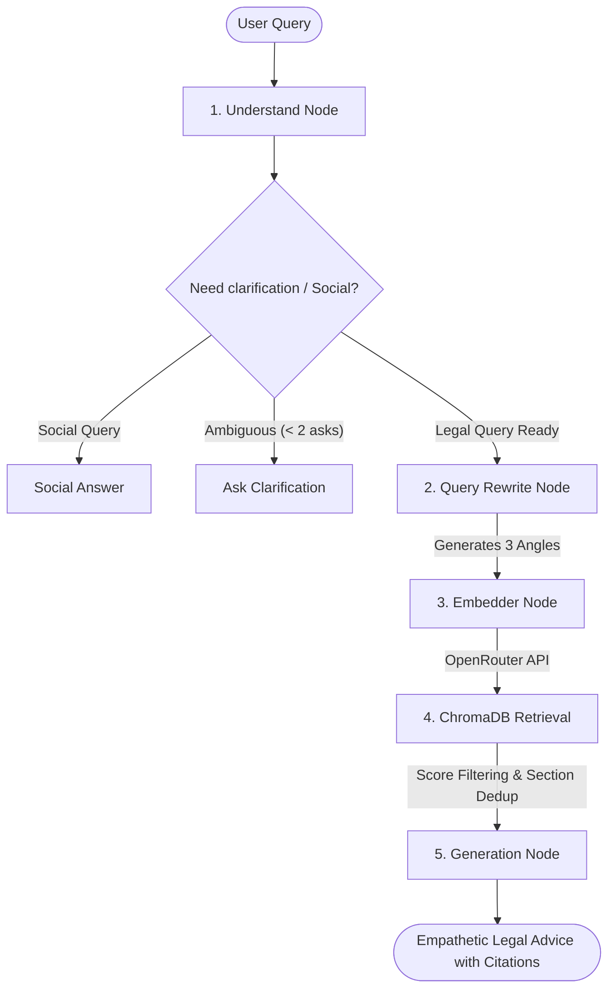

<div align="center">

# ⚖️ Sakhi — Production Legal RAG Architecture

**An empathetic, production-ready legal reasoning companion built with LangGraph, ChromaDB, FastAPI, and React.**

Developed & Maintained by **[Divya (CodeBy-Divya)](https://github.com/CodeBy-Divya)**

[](https://github.com/CodeBy-Divya)
[](https://python.org)
[](https://fastapi.tiangolo.com)
[](https://langchain-ai.github.io/langgraph/)
[](https://trychroma.com)
[](https://react.dev)
[](LICENSE)

</div>

---

## 📌 What is This Architecture?

**Sakhi** is a specialized, multi-turn **Retrieval-Augmented Generation (RAG)** system tailored for legal information. Most individuals find statutory texts and legal terminology intimidating or inaccessible. Sakhi bridges this gap by accepting natural user queries (in English, Hindi, or Hinglish slang like *"FIR dala"* or *"salary nahi mili"*), identifying the underlying statutory domain, retrieving verbatim clauses from over 40 Indian Acts, and delivering empathetic, actionable guidance with exact legal section citations.

---

## 🛠️ Tools & Technologies Used

| Layer | Technology | Purpose & Details |
| :--- | :--- | :--- |
| **Workflow & State** | **LangGraph (`CompiledStateGraph`)** | Cyclic multi-node state graph for intent detection, query rewriting, deduplication, and conditional routing. |
| **API Server** | **FastAPI + Uvicorn** | High-performance asynchronous REST API with non-blocking thread-pool executors for heavy LLM calls, lifespan management, and dynamic CORS. |
| **Vector Database** | **ChromaDB (`v0.6+`)** | Embedded vector database storing 7,617 legal chunks indexed with HNSW. |
| **Vector Embeddings** | **Qwen3-Embedding-8B (via OpenRouter)** | High-dimensional multilingual text embeddings capable of capturing English, Hindi, and transliterated queries. |
| **LLM Reasoning** | **Groq Cloud (`openai/gpt-oss-120b`)** | Ultra-low-latency statutory reasoning with fallback to `openai/gpt-oss-20b`. |
| **Document Processing** | **PyMuPDF (`fitz`) & Text Processors** | PDF parsing, statutory section extraction, metadata tagging (Act, Category, Section Number). |
| **Frontend UI** | **React 19 + TypeScript + Vite 6** | Fluid client interface with streaming state, auto-resizing input, and Markdown formatting. |
| **Styling & Icons** | **Tailwind CSS + Lucide Icons** | Modern glassmorphism dark theme with responsive typography. |

---

## 🔄 RAG Pipeline Architecture

Sakhi uses a five-stage cyclic state graph:



### Detailed Pipeline Stages:

1. **Understand Node (`understand_query`)**:
   - Inspects conversation history and fixes Indian slang and typos.
   - Evaluates whether the query requires clarification (capped at a maximum of 2 clarifying questions to avoid frustrating users).
   - Classifies non-legal social small talk to bypass retrieval.

2. **Query Rewrite Node (`rewrite_query`)**:
   - Decomposes the user's situation into 3 targeted search angles:
     1. Formal statutory legal terminology.
     2. Everyday plain-language query.
     3. Specific Act and Section name candidate.

3. **Embedder Node (`embed_queries`)**:
   - Encodes all search query vectors using OpenRouter's `qwen/qwen3-embedding-8b`.

4. **ChromaDB Retrieval Node (`retrieve_chunks`)**:
   - Queries ChromaDB using multi-vector similarity search ($k=8$).
   - Deduplicates results by legal section so multiple overlapping chunks from the same statute do not crowd the prompt context.
   - Filters out irrelevant candidates below the relevance threshold.

5. **Generation Node (`generate_answer`)**:
   - Synthesizes the retrieved statutory sections through the LLM.
   - Structures output: **Validate & Comfort** $\rightarrow$ **Legal Reality** $\rightarrow$ **Practical Next Steps** $\rightarrow$ **Exact Act & Section Citations**.

---

## 📂 Project Structure

```text
sakhi/
├── data/
│   ├── pdfs/                 # 40+ Official Indian Law Acts (BNS, Civil, Labour, etc.)
│   └── txt/                  # Pre-extracted statutory raw text
├── sakhi-ui/                 # React 19 + Vite 6 Frontend
│   ├── src/
│   │   ├── App.tsx           # Chat interface & API client
│   │   ├── index.css         # Dark glassmorphic theme
│   │   └── main.tsx          # Application entrypoint
│   └── package.json
├── src/
│   ├── api/
│   │   └── main.py           # FastAPI entrypoint, routes, & health checks
│   ├── core/
│   │   └── rag.py            # LangGraph StateGraph & prompt definitions
│   ├── ingest/
│   │   ├── chroma_store.py   # ChromaDB collection management
│   │   ├── embedder.py       # Embedding generation logic
│   │   └── loader.py         # Legal chunk loader
│   ├── pipeline/
│   │   ├── extract_pdfs.py   # PDF text extractor
│   │   └── text_to_json.py   # Chunking and section metadata generator
│   └── config.py             # System prompts, models, and thresholds
├── .env.example              # Environment template
├── Dockerfile                # Container definition
├── requirements.txt          # Python dependencies
├── run_app.ps1               # One-click Windows runner
└── run_app.sh                # Linux/macOS runner
```

---

## 🚀 Quickstart Guide

### 1. Prerequisites
- **Python 3.10 or 3.11**
- **Node.js 18+ & npm**
- **Free API Keys**:
  - [Groq API Key](https://console.groq.com)
  - [OpenRouter API Key](https://openrouter.ai/keys)

### 2. Environment Configuration
Copy `.env.example` to `.env` and fill in your keys:
```bash
cp .env.example .env
```
Inside `.env`:
```env
GROQ_API_KEY=your_groq_api_key_here
OPENROUTER_API_KEY=your_openrouter_api_key_here
GROQ_MODEL=openai/gpt-oss-120b
PORT=8000
```

### 3. Running on Windows
Execute the automated PowerShell runner:
```powershell
.\run_app.ps1
```

### 4. Running Manually

#### Backend:
```bash
python -m venv .venv
source .venv/bin/activate  # Or on Windows: .\.venv\Scripts\Activate.ps1
pip install -r requirements.txt
python -m src.api.main
```
Backend will start at **http://localhost:8000** (Check `/health`).

#### Frontend:
```bash
cd sakhi-ui
npm install
npm run dev
```
Frontend will be live at **http://localhost:5173**.

---

## ⚖️ Legal Disclaimer

Sakhi is designed exclusively for educational and informational purposes under Indian Law. It is not an attorney and does not establish an attorney-client relationship. For active court litigation or emergency assistance, users are guided to official free legal assistance bodies:
- **NALSA (National Legal Services Authority)**: Free legal representation for eligible individuals across all districts in India.
- **Police Emergency**: Dial `112`
- **Women Helpline**: Dial `181`

---

<div align="center">

**Created with ❤️ by [Divya](https://github.com/CodeBy-Divya)**

</div>
